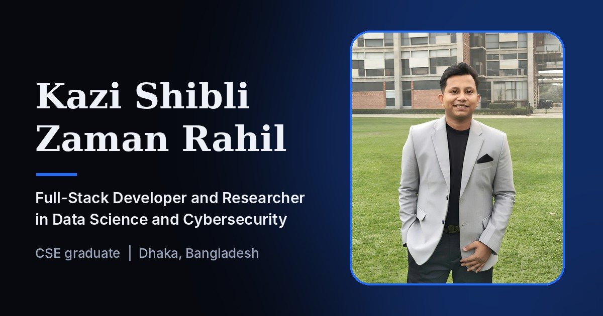

<h1 align="center">Kazi Shibli Zaman Rahil | Portfolio</h1>

<p align="center">
  Personal portfolio of a Full-Stack Developer and Researcher in Data Science and Cybersecurity.
</p>

<p align="center">
  <a href="https://kazishiblizamanrahil.dev"></a>
</p>

<p align="center">
  <a href="https://kazishiblizamanrahil.dev"></a>
</p>

---

## What's inside

- **Home:** animated name introduction, role summary, social links, a live Dhaka clock and quick stats
- **About and Now:** who I am, what I'm working towards, and what I'm focused on right now
- **Education and Skills:** a timeline of my studies and skill cards with icons, filterable by area
- **Projects:** six projects in a swipeable carousel. Each project has its own page with the real-life problem, solution, key features, system architecture, tech stack and a link to its GitHub repository
- **Research:** six research papers. Each has its own page with the real-life problem, how the research solves it, the full abstract and the technical aspects
- **Awards, Achievements and Activities:** awards, clubs and a photo gallery with an enlarge view
- **Contact:** email, WhatsApp, GitHub, LinkedIn and downloads for my CV and resume

**Design and usability**
- Floating navigation bar with a sliding active indicator and a scroll-progress line
- Dark and light mode, remembered per visitor
- Fully responsive layout for phones, tablets and desktops
- Sliding hover highlights on button groups
- Floating "Resume & CV" download menu
- Respects the "reduce motion" setting for visitors who prefer less animation

**Search and sharing**
- Open Graph and Twitter preview tags with a share image
- Structured data (JSON-LD) describing me and linking my profiles
- `sitemap.xml`, `robots.txt`, a canonical address, favicon and touch icons

---

## Built with

| Area | Technology |
| --- | --- |
| Structure and logic | HTML5 and vanilla JavaScript (no framework, no build step) |
| Styling | CSS3 with custom properties for the colour theme |
| Fonts | Inter (Google Fonts) and the Cambria font family for my name |
| Hosting | GitHub for the code and Cloudflare for deployment, on a custom `.dev` domain with HTTPS |

---

## Project structure

```
Rahil-Portfolio/
├── index.html                              page content and all JavaScript
├── style.css                               all styling and the colour theme
├── favicon.ico                             browser tab icon
├── robots.txt                              search engine rules
├── sitemap.xml                             sitemap for Google
├── Kazi-Shibli-Zaman-Rahil_CV.pdf          CV
├── Kazi-Shibli-Zaman-Rahil_Resume.pdf      resume
└── images/                                 photos, project covers, gallery, tab icons and share image
```

---

## Run it on your computer

No installation is needed:

1. Download or clone the repository.
2. Open `index.html` in a browser.

An internet connection is needed for the Inter font. For a local server, use the **Live Server** extension in VS Code.

```bash
git clone https://github.com/Rahil03-git/Rahil-Portfolio.git
cd Rahil-Portfolio
```

## Deployment

Every push to the `main` branch is deployed automatically through Cloudflare to **https://kazishiblizamanrahil.dev**.

```bash
git add .
git commit -m "Describe your change"
git push
```

---

## Featured projects shown on the site

| Project | Repository |
| --- | --- |
| H.E.X | [HEX-Health-Education-Exploration](https://github.com/Rahil03-git/HEX-Health-Education-Exploration) |
| GlobalEdX | [GlobalEdX-Study-Abroad-Guidance-Platform](https://github.com/Rahil03-git/GlobalEdX-Study-Abroad-Guidance-Platform) |
| EdAcademix | [EdAcademix-Study-Abroad-IELTS-Platform](https://github.com/Rahil03-git/EdAcademix-Study-Abroad-IELTS-Platform) |
| UIU ResearchCollab | [UIU-ResearchCollab-Research-Collaboration-Portal](https://github.com/Rahil03-git/UIU-ResearchCollab-Research-Collaboration-Portal) |
| AgriSense | [AgriSense-Smart-Agriculture-Drone-and-Soil-Station](https://github.com/Rahil03-git/AgriSense-Smart-Agriculture-Drone-and-Soil-Station) |
| Automated Saltwater Aquarium | [Automated-Saltwater-Aquarium-Arduino-Mega](https://github.com/Rahil03-git/Automated-Saltwater-Aquarium-Arduino-Mega) |

---

## Contact

- Email: [iamksrahil03@gmail.com](mailto:iamksrahil03@gmail.com)
- LinkedIn: [linkedin.com/in/iamrahil](https://linkedin.com/in/iamrahil)
- GitHub: [Rahil03-git](https://github.com/Rahil03-git)
- Portfolio: [kazishiblizamanrahil.dev](https://kazishiblizamanrahil.dev)

I'm open to full-time and remote opportunities, and I welcome feedback on the site.

---

## Copyright

© 2026 Kazi Shibli Zaman Rahil. All rights reserved. The text, photos, CV, research summaries and project descriptions are personal content. Please don't reuse them without permission.
